# SmartOps-Lite

> **Event-driven AIOps for Kubernetes on the AWS free tier.** When a pod crashes, a Kubernetes controller publishes the incident to Amazon EventBridge. A Lambda asks an LLM (Groq) for a two-sentence root cause, stores the incident in DynamoDB and posts a Slack card. A second Lambda turns the incident table into CloudWatch metrics every 5 minutes. Crash to Slack takes about 5 seconds.

[](https://github.com/DhanyaM2001/smartops-lite/actions/workflows/ci.yml)
[](https://github.com/DhanyaM2001/smartops-lite/actions/workflows/security.yml)
[](#verified-in-the-recorded-run)
[](https://www.python.org/downloads/release/python-3120/)
[](https://developer.hashicorp.com/terraform/downloads)
[](#cost)

**Status:** v1.0. Built and run end-to-end on a real AWS account on **25 Sep 2026**, recorded as a demo, then torn down with `make eod`. Nothing is running now; [`docs/INSTALL.md`](docs/INSTALL.md) rebuilds it from scratch.
**Author:** Dhanya M

---

## Contents

- [The problem](#the-problem)
- [The solution](#the-solution)
- [Architecture](#architecture)
- [End-to-end flow](#end-to-end-flow)
- [Components](#components)
- [What Terraform creates](#what-terraform-creates)
- [Design decisions](#design-decisions)
- [Security](#security)
- [Cost](#cost)
- [Verified in the recorded run](#verified-in-the-recorded-run)
- [Screenshots](#screenshots)
- [Known limitations](#known-limitations)
- [Quickstart](#quickstart)
- [Repository layout](#repository-layout)
- [Documentation map](#documentation-map)

---

## The problem

When a pod crashes in Kubernetes, the platform restarts the container. It doesn't tell anyone why the container died. An on-call engineer still has to notice, run `kubectl describe` and `kubectl logs --previous`, work out a probable cause and write it down somewhere. Most of the time to recovery goes on that triage.

Commercial AIOps tools automate this, but they cost money. So does the usual AWS stack for this: an EKS control plane alone is about $73/month. This project asks whether the whole loop (detect, explain, notify, record, measure) can run for $0 on the AWS free tier.

## The solution

SmartOps-Lite automates the triage step:

1. **Detect.** A small Python controller inside the cluster watches every pod. It reports specific failures such as non-zero exits, `OOMKilled`, `CrashLoopBackOff`, image-pull errors and failed pods, and ignores repeats.
2. **Explain.** A Lambda sends the failure details to Groq's hosted LLM (`qwen/qwen3.8-27b`) and gets back a probable cause plus the next command to run. If Groq is slow or down, the Lambda uses a fallback text and carries on.
3. **Notify.** A Slack Block Kit card shows the pod, node, zone, exit code, restart count and the RCA, about 5 seconds after the crash.
4. **Record.** Every incident becomes a DynamoDB row, so there's an audit trail with the RCA text.
5. **Measure.** Every 5 minutes, a scheduled Lambda publishes incident count, acknowledgement rate and LLM success rate to CloudWatch.

Kubernetes still does the recovery: the kubelet restarts the crashed container within a second or so. SmartOps-Lite explains and records what happened; it doesn't change the cluster.

---

## Architecture

```
 Laptop (VS Code devcontainer): terraform · make · kubectl · helm · docker
     │  kubectl / helm ── SSM port-forward to 127.0.0.1:6443 (no inbound ports open)
     │  docker push ───── 2 private ECR repos; the nodes pull with their IAM role
     ▼
 AWS ap-south-1 · VPC with 2 public subnets · no NAT gateway
 ┌─ K3s v1.36 on 2 × EC2 t3.micro ────────────────────────────────────────────────┐
 │  server node · ap-south-1a              agent node · ap-south-1b               │
 │    crashy-app pod #1                       crashy-app pod #2                   │
 │                                            smartops-controller                 │
 │                                            (watches every pod)                 │
 └──────────────────────────────────────────────────┬─────────────────────────────┘
                                                    │ PutEvents "IncidentDetected"
                                                    ▼
                                  EventBridge custom bus "smartops-dev"
                                                    │ rule → target
                                                    ▼
  SSM SecureStrings ◀─ cold start ─ rca-generator Lambda ── HTTPS ──▶ Groq API (external)
  slack_webhook, groq_api_key           │              │              qwen/qwen3.8-27b
                                PutItem ▼              ▼ POST Block Kit
                          DynamoDB "smartops-incidents"  Slack incoming webhook (external)
                                        ▲
                                        │ Scan, last 60 min
  schedule rate(5 min) ──▶ mttr-aggregator Lambda ──▶ CloudWatch metrics "SmartOps"

  Built and tested, not connected in v1.0: remediator Lambda + Function URL (Slack "Acknowledge")
```

The controller pod can be scheduled on either node; in the recorded run it ran on the agent. Colour diagrams are in [`docs/END-TO-END.md`](docs/END-TO-END.md), and their Mermaid sources are in [`docs/diagrams/`](docs/diagrams/).

---

## End-to-end flow

This is what happens for one crash. The timings are real, from incident `987b244e` in the recorded run (UTC). The controller publish time and the Lambda log lines are exact. The crash time itself wasn't logged, so the first step is approximate.

| # | Step | What happens | Observed |
|---|---|---|---|
| 1 | **Crash** | `make chaos-crash` port-forwards to the crashy-app Service and calls `GET /crash`. The app calls `os._exit(1)`. | — |
| 2 | **Recover** | The kubelet restarts the container (`restartPolicy: Always`). RESTARTS goes 0 → 1, and READY returns to `1/1`. | ~1 s |
| 3 | **Detect** | The controller sees `lastState.terminated.reason = Error` with exit code 1. It checks the dedup cache for `(namespace, pod, container, reason)`, then calls `PutEvents` with a schema-1.0 `IncidentDetected` event. | published 12:10:28.4 |
| 4 | **Route** | The EventBridge rule `smartops-lite-incident-detected` matches `source = smartops.controller` and invokes the RCA Lambda. | 12:10:28 Lambda start |
| 5 | **Explain** | On a cold start the Lambda reads 2 SSM SecureStrings in one `GetParameters` call. It then sends a structured prompt to Groq (10 s timeout, 200 max tokens). | 12:10:31 RCA received |
| 6 | **Record** | `PutItem` into `smartops-incidents` with `rcaText`, `rcaSource = groq`, `rcaStatus = generated` and `ingestedAt`. | 12:10:31 |
| 7 | **Notify** | Slack Block Kit card: header by reason, pod, node, zone, exit code, restarts, RCA text and footer. | 12:10:32 Slack HTTP 200 |
| 8 | **Measure** | Every 5 minutes, or on `make invoke-mttr`, the aggregator scans the last 60 minutes of rows and publishes the metrics. | ≤ 5 min |

That's about 4 seconds from the controller's publish to the Slack card on a cold Lambda, and about 5 seconds from the crash. The Lambda ran for 3.0–3.3 s on cold starts and 0.5 s warm, using 99 MB of its 256 MB.

When the LLM fails, steps 6 and 7 still happen. In the run, Groq once didn't answer within 10 s. The Lambda logged `groq call failed (soft) … The read operation timed out`, stored the row with `rcaSource = fallback` and `rcaStatus = pending`, and posted the card headed "RCA (fallback)" about 12 s after the crash.

---

## Components

| Component | Tech | Runs on | What it does |
|---|---|---|---|
| [`apps/crashy-app`](apps/crashy-app/) | FastAPI, Python 3.12 | K3s, 2 replicas | Demo service with failure endpoints `GET /crash`, `/oom`, `/500` and `/slow`. Its Helm chart has **hard** pod anti-affinity on `topology.kubernetes.io/zone`, so there's one replica per AZ. |
| [`controller`](controller/) | Python, `kubernetes` client, boto3 | K3s, 1 replica, namespace `smartops` | Watches all pods (except `kube-system`, `kube-public`, `kube-node-lease` and `smartops`). Detects 7 bad waiting reasons, `OOMKilled`, non-zero `Error` exits and `phase=Failed`. Keeps an in-memory LRU dedup of 4096 entries and publishes to EventBridge. |
| [`lambdas/rca-generator`](lambdas/rca-generator/) | Python 3.12, stdlib `urllib` | Lambda 256 MB / 60 s | Validates the event schema, calls Groq with fail-soft fallback, writes to DynamoDB and posts the Slack Block Kit card. |
| [`lambdas/mttr-aggregator`](lambdas/mttr-aggregator/) | Python 3.12 | Lambda 128 MB / 30 s | `rate(5 minutes)`. Scans the last 60 minutes of incidents and publishes `IncidentCount`, `AckedIncidentCount`, `AckRatePercent` and `LLMSuccessRatePercent`, plus `MTTRSecondsAvg` once something has been acknowledged. |
| [`lambdas/remediator`](lambdas/remediator/) | Python 3.12, HMAC-SHA256 | Lambda 256 MB / 10 s + Function URL | Receiver for the Slack "Acknowledge" button. It verifies Slack's signature with a constant-time compare and a 5-minute replay window, then marks the row `acknowledged`. **Deployed but not connected to Slack** (see [limitations](#known-limitations)). |
| [`infra/`](infra/) | Terraform 1.7.5, AWS provider | your laptop | 8 reusable modules (`vpc`, `security-group`, `iam`, `k3s`, `ecr`, `eventbridge`, `dynamodb`, `lambda`) plus `envs/dev`. State is in S3 with a DynamoDB lock. |
| [`helm/`](helm/) | Helm 3 | your laptop | Charts `crashy-app` (release `app`, namespace `demo`) and `smartops-controller` (release `ctrl`, namespace `smartops`). |
| [`scripts/`](scripts/) + [`Makefile`](Makefile) | bash, make | your laptop | One entry point for everything: bootstrap, secrets, deploy, chaos, demo, teardown. Run `make help` to list it all. |
| [`.devcontainer/`](.devcontainer/) | Docker, VS Code Dev Containers | your laptop | Pinned toolchain: Terraform 1.7.5, AWS CLI v2 + Session Manager plugin, kubectl, Helm, Python 3.12, Poetry, jq, yq, gh. |
| [`.github/`](.github/) | GitHub Actions, Dependabot | GitHub | `ci.yml` (lint, validate, test), `security.yml` (Trivy filesystem + IaC, Gitleaks) and weekly Dependabot updates. No AWS credentials in CI. |

---

## What Terraform creates

`make tf-apply` creates **49 managed resources** in `ap-south-1`:

| Area | Resources |
|---|---|
| Network | VPC, internet gateway, 2 public subnets (1a, 1b), route table + 2 associations, security group with self-only ingress and all egress. No NAT gateway, no load balancer. |
| Compute | 2 EC2 `t3.micro` running Ubuntu 24.04 with 15 GB gp3 each: K3s server in 1a, agent in 1b. The cloud-init bootstrap is described below. |
| Node IAM | Role + instance profile with `AmazonSSMManagedInstanceCore`, `AmazonEC2ContainerRegistryReadOnly`, `events:PutEvents` on one bus, and SSM read/write scoped to `/smartops/dev/*`. |
| Containers | 2 private ECR repositories (`smartops/controller`, `smartops/crashy-app`) with lifecycle policies |
| Events | Custom bus `smartops-dev` + incident rule + target. The `rate(5 minutes)` schedule rule + target sit on the default bus. |
| Data | DynamoDB table `smartops-incidents` (on-demand, key `incidentId`) |
| Serverless | 3 Lambdas, each with its own IAM role, inline least-privilege policy, basic-execution attachment and log group (14-day retention). Also the remediator Function URL and 2 EventBridge invoke permissions. |

**Created once, kept between sessions** (`make bootstrap-backend`, `make put-secrets`): the S3 state bucket `smartops-lite-tf-state-<account-id>`, the DynamoDB lock table `smartops-lite-tf-lock`, and the SSM SecureStrings `/smartops/dev/slack_webhook` and `/smartops/dev/groq_api_key`.

**What each node does on first boot** ([`cloud-init.yaml.tftpl`](infra/modules/k3s/cloud-init.yaml.tftpl)):
- Masks unused Ubuntu services (fwupd, ModemManager, udisks2, multipathd, packagekit, unattended-upgrades and others) and adds 1 GiB of swap.
- Installs AWS CLI v2 and the ECR credential provider.
- Installs K3s with traefik, servicelb, metrics-server and local-storage disabled, and labels the node with its zone from instance metadata.
- On the server only: uploads the kubeconfig, join token and private server URL to SSM, then writes its own instance ID as a "ready" stamp.
- On the agent only: waits for that stamp before joining.

---

## Design decisions

Each decision was made against written alternatives; see [`docs/adr/`](docs/adr/) and the [module runbooks](docs/modules/).

1. **K3s on 2 × t3.micro, not EKS.** EKS charges about $73/month for the control plane alone. K3s is a single binary with no control-plane fee. Two nodes in two AZs make zone anti-affinity real. The trade-off is that a t3.micro has 1 GiB of RAM, half the K3s server minimum. The first nodes ran out of memory. The fix that kept it free was disabling the unused K3s add-ons and Ubuntu services and adding 1 GiB of swap, rather than moving to `t3.small`. [ADR-001](docs/adr/001-k3s-vs-eks.md)
2. **Groq's hosted LLM, with fail-soft fallback.** Groq is free at demo volume, OpenAI-compatible and usually fast, and it's called with stdlib `urllib`, so the Lambda has no extra dependencies. The model is a Terraform variable. That mattered: Groq retired `llama-3.3-70b-versatile` mid-project (HTTP 404), and switching to `qwen/qwen3.8-27b` was a one-line, in-place Lambda update. The LLM can never block alerting, because a timeout or error still writes the row and sends the card. [ADR-002](docs/adr/002-ai-backend-choice.md)
3. **EventBridge between the cluster and AWS, not direct calls.** The controller only knows "put an event on a bus". Routing, retries and future consumers (for example a remediation executor) plug in with rules, without changing the controller.
4. **Node IAM instead of IRSA.** IRSA on K3s needs a self-hosted OIDC issuer and per-service-account trust policies. For a single-tenant demo cluster, a node role with per-ARN statements is far less code. The controller uses the default boto3 credential chain, so IRSA can replace it later without Python changes. The cost is a wider blast radius; see [Security](#security). [Module 4 runbook](docs/modules/04-controller.md)
5. **Aggregator Lambda + CloudWatch, not Prometheus on the cluster.** Prometheus would need RAM that a 1 GiB node doesn't have. A 128 MB Lambda every 5 minutes publishes at most 5 metric series with no dimensions, which stays inside the 10-metric free allowance. [Module 9 runbook](docs/modules/09-observability.md)
6. **No inbound ports at all.** The security group only allows traffic between the nodes. `kubectl` reaches the K3s API through an SSM Session Manager port-forward (`make kube-api-tunnel`), so there's no SSH, no bastion and no public 6443.
7. **Fail loud on bad input, fail soft on side effects.** A malformed event raises an error, so EventBridge retries it. A Slack or Groq failure is logged and never loses the DynamoDB row. The DynamoDB write is idempotent on `incidentId`.

---

## Security

- **No secrets in the repo or in Terraform state.** The Slack webhook and Groq key are typed into a hidden prompt (`read -rsp`), sent to SSM as SecureStrings by `make put-secrets`, and then `unset`. `make verify-secrets` shows names and metadata only, never values.
- **Least privilege per Lambda.**
  - RCA Lambda: `PutItem`/`UpdateItem`/`GetItem` on one table, and `GetParameter(s)` on exactly two parameter ARNs.
  - Aggregator: `Scan` on one table, and `PutMetricData` only when `cloudwatch:namespace = SmartOps`.
  - Remediator: one table, one bus, and only the signing-secret parameter.
  - Every Lambda's `kms:Decrypt` is conditioned on `kms:ViaService = ssm.<region>.amazonaws.com`.
- **Node role trade-off (honest version).** Any pod on the nodes can use the node role through instance metadata. That allows `events:PutEvents` on the SmartOps bus, ECR pulls, and reading and decrypting **every** `/smartops/dev/*` parameter, which includes the Groq key and Slack webhook. It also allows writing the four K3s bootstrap parameters. That's acceptable for a single-tenant demo. IRSA, or narrowing the read to the K3s parameters, is the production fix.
- **Remediator endpoint.** The Function URL is public by design (Slack must reach it) and rejects any request without a valid Slack HMAC signature.
- **Supply chain.** Trivy scans the filesystem and IaC, and Gitleaks scans the full git history on every push and weekly. Dependabot covers 5 Python packages, Terraform, 2 Dockerfiles and GitHub Actions.

---

## Cost

**Target: $0. Billed: $0.**

- **The account.** The project ran on a new AWS account on the **Free plan**, the credit-based plan for accounts created after 15 Jul 2025. Usage drew from free credits and nothing was billed. The account's free period ended on 26 Sep 2026, the day after the recording.
- **What keeps it free.**
  - `t3.micro` only, with 2 × 15 GB of EBS (inside the 30 GB allowance).
  - No NAT gateway, load balancer, EKS or Secrets Manager.
  - Lambda, DynamoDB on-demand, EventBridge, SSM standard parameters and CloudWatch all stay far below their free allowances at demo volume.
  - Groq's free tier for the LLM.
- **Daily discipline.** `make eod` destroys all 49 workload resources at the end of every session. Only the state bucket, lock table and SSM parameters remain between sessions, and they cost effectively nothing.
- **The commands that cost money.** AWS Cost Explorer charges **$0.01 per API call**. That covers `make status`, `make cost`, `make cost-by-service` and any `aws ce …` command, and `make demo` calls it only if you set `SHOW_COST=true`. The install guide uses the free Billing console instead.

Per-service allowances are in [`docs/06-cost-tracker.md`](docs/06-cost-tracker.md).

---

## Verified in the run

| Check | Result |
|---|---|
| `terraform validate` / `terraform fmt -check` | Pass / no changes |
| `terraform plan` against the live stack | `No changes.` (no drift); 49 resources in state |
| Cluster | 2 nodes `Ready`, K3s `v1.36.4+k3s1`, zones `ap-south-1a` and `ap-south-1b` |
| Pod spread | crashy-app: one replica per zone (`make chaos-spread` ✓); controller `1/1 Running` |
| Lambdas | `rca-generator` 256 MB/60 s, `remediator` 256 MB/10 s, `mttr-aggregator` 128 MB/30 s, all Python 3.12 |
| Incidents in DynamoDB | 5: 3 real crashes (`Error`, exit 1) and 2 `PodFailed` alerts caused by `make demo-reset` (see limitations) |
| RCA source | 4 × `groq` / `generated`, 1 × `fallback` / `pending` (Groq timed out after 10 s) |
| Slack | Every incident posted (HTTP 200) |
| CloudWatch `SmartOps` | `IncidentCount`, `AckedIncidentCount`, `AckRatePercent`, `LLMSuccessRatePercent` |
| Unit tests (`make test`) | **159 passed**: crashy-app 8, controller 19, rca-generator 60, remediator 40, mttr-aggregator 32 |
| Teardown | `make eod` completed; Lambda/ECR/EC2/DynamoDB incidents table gone, state bucket + SSM kept |

---

## Screenshots

**Slack alert with the AI root-cause analysis**

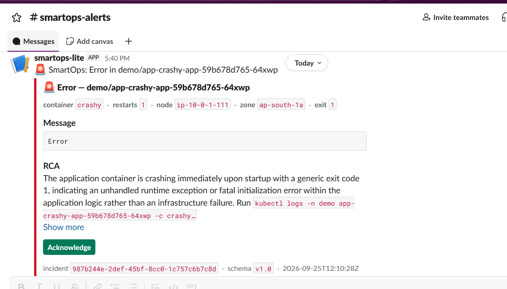

**The two K3s nodes in two zones (`kubectl get nodes`)**

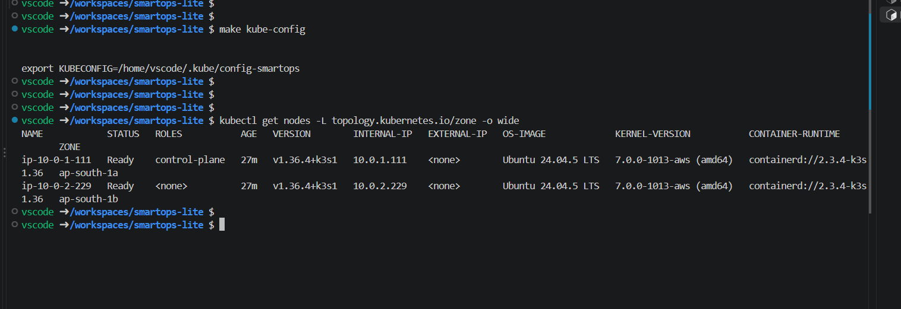

**The helm list of deployment (`helm list -A`)**

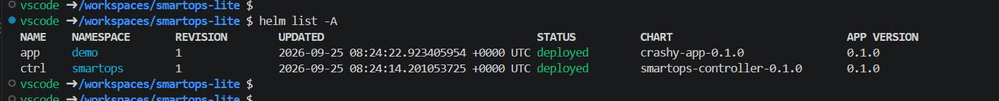

**The K3s PODS from the terminal (`kubectl get pods`)**

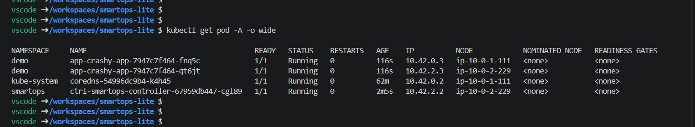

**Incidents stored in DynamoDB (`smartops-incidents`)**

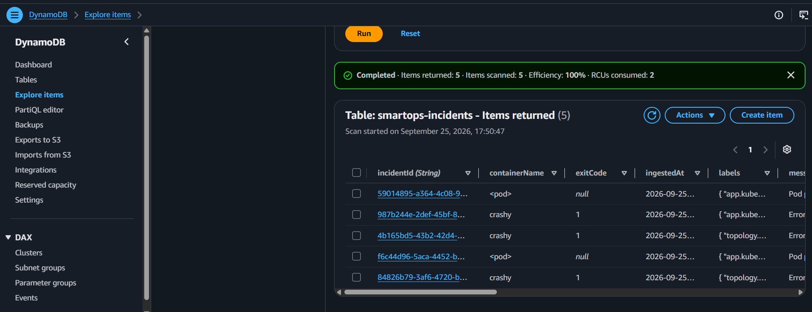

**CloudWatch metrics for the RCA Lambda**

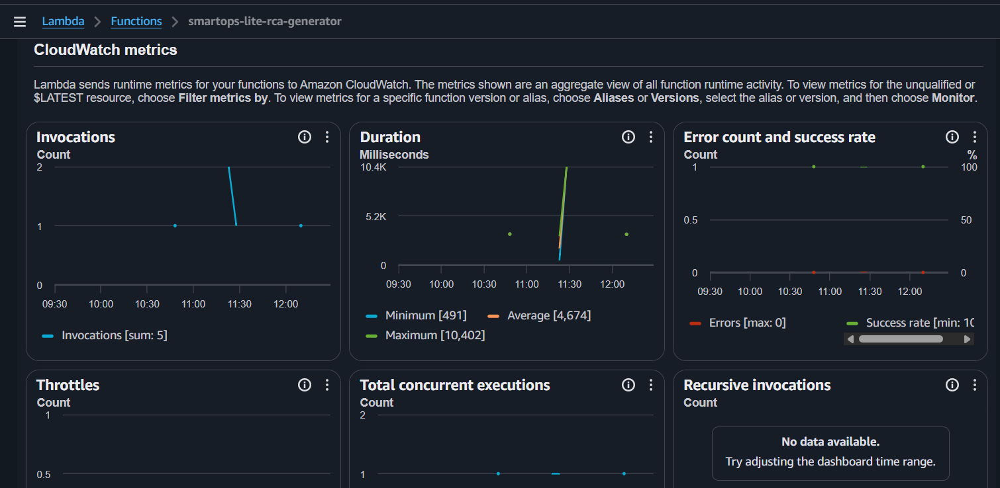

**RCA Lambda overview (smartops-lite-rca-generator)**

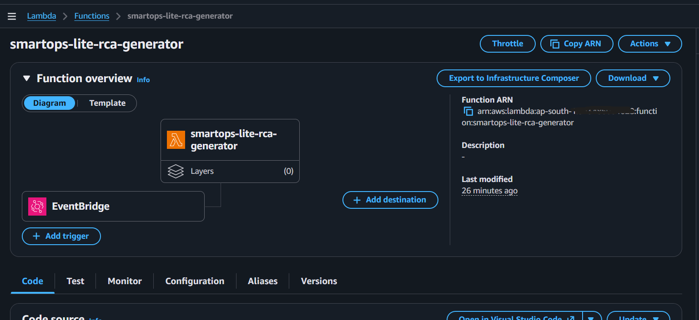

**EventBridge rule that triggers the RCA Lambda**

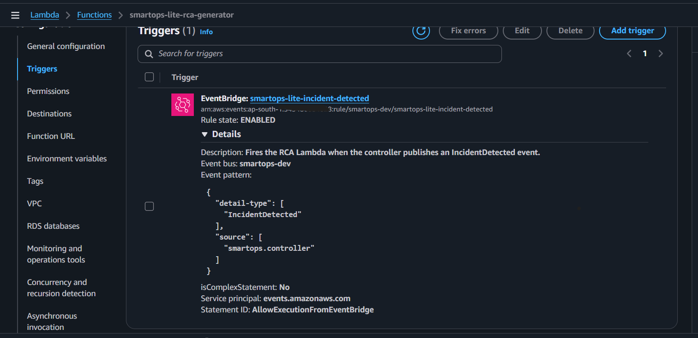

**ECR Repositories**

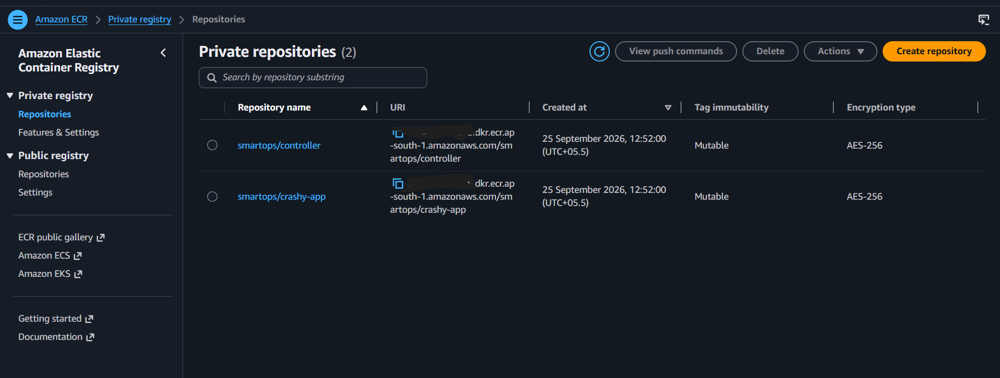

**EC2 Instances (K3s server and agent)**

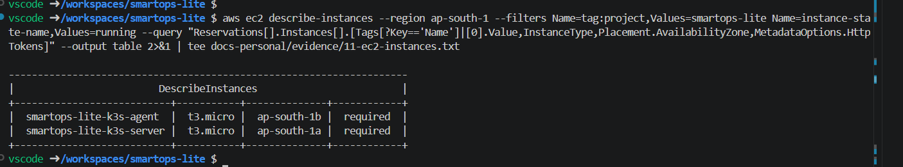

**The three Lambda function**

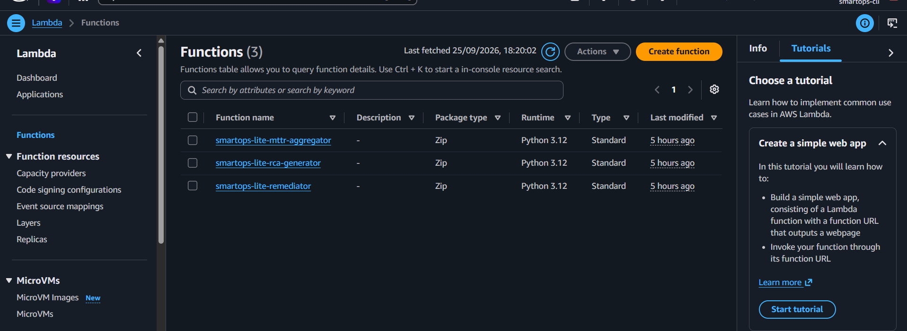

---

## Known limitations

These are the honest edges of v1.0, all seen in the run or visible in the code:

- **The Slack "Acknowledge" button isn't connected.** The remediator Lambda, its Function URL and its 40 tests exist, but the Slack app's Interactivity URL and signing secret were never configured, so a click doesn't reach AWS. As a result `AckRatePercent` is 0 and `MTTRSecondsAvg` is never published. To connect it, run `make remediator-url` and `make put-signing-secret`, then enable Interactivity in the Slack app.
- **There's no automatic remediation.** `allowed_remediation_reasons` is empty by default, and nothing consumes `RemediationRequested` events. Kubernetes restarts the container; SmartOps-Lite explains and records.
- **False `PodFailed` alerts during rollouts.** Kubernetes marks a pod that's being deleted as `Failed` if its container exits non-zero. The detector doesn't check `deletionTimestamp`, so `make demo-reset` posted two false cards in the run.
- **One alert per pod per reason.** The dedup key has no TTL, so a second crash of the same pod is silent. Crash the other replica, or run `make demo-reset` to get new pod names. The cache lives in memory, so a controller restart can re-report crashes still visible in pod status.
- **One LLM provider with a 10 s timeout.** If Groq is slow you get "RCA (fallback)". The row and card still arrive.
- **The t3.micro server is below the K3s minimum.** It ran the demo stably with swap and the add-ons disabled; it isn't sized for real workloads.
- **No dead-letter queue or alarms** on Lambda failures; only EventBridge's built-in retries.
- **The Grafana dashboard is optional and wasn't set up.** [`dashboards/grafana/`](dashboards/grafana/) contains an importable dashboard for the CloudWatch metrics, but the recorded run used the CloudWatch console.
- **The local `kind` path didn't work on Docker Desktop for Windows.** The kubelet fails because the cgroup v2 `cpuset` controller isn't delegated, and even when it works the controller runs in dry-run mode. The AWS path is the real one.
- **`make up` isn't a one-shot on a fresh deploy.** Helm needs the SSM tunnel open and the images in ECR first, so follow the step order in the install guide.

---

## Quickstart

The full guide, with expected output and fixes for every problem hit during the real run, is **[`docs/INSTALL.md`](docs/INSTALL.md)**. It takes about 90 minutes the first time. In outline:

```bash
# One time: accounts (AWS, Groq, Slack webhook), then open the repo in the devcontainer
aws configure --profile smartops && export AWS_PROFILE=smartops
make bootstrap-backend                 # S3 state bucket + DynamoDB lock table
make put-secrets                       # Slack webhook + Groq key from hidden prompts → SSM

# Every session
make tf-init && make tf-apply          # 49 resources
make kube-config                       # waits for the server, writes ~/.kube/config-smartops
make kube-api-tunnel                   # terminal 1: keep open
export KUBECONFIG=~/.kube/config-smartops   # terminal 2 onwards
make docker-push-controller && make docker-push-crashy
make helm-install
make chaos-crash                       # → Slack card in ~5 s
make eod                               # type YES — destroys everything billable
```

---

## Repository layout

```
smartops-lite/
├── README.md                    ← you are here: what it is and how it's built
├── Makefile                     ← single entry point (`make help`)
├── apps/crashy-app/             ← FastAPI demo service (/crash /oom /500 /slow)
├── controller/                  ← pod watcher → EventBridge
├── lambdas/
│   ├── rca-generator/           ← EventBridge → Groq → DynamoDB → Slack
│   ├── mttr-aggregator/         ← 5-min schedule → DynamoDB scan → CloudWatch
│   └── remediator/              ← Slack Ack receiver (built, not connected)
├── helm/{crashy-app,smartops-controller}/
├── infra/
│   ├── envs/dev/                ← root module (state in S3, lock in DynamoDB)
│   └── modules/{vpc,security-group,iam,k3s,ecr,eventbridge,dynamodb,lambda}/
├── dashboards/grafana/          ← optional CloudWatch dashboard
├── scripts/                     ← bootstrap, secrets, chaos, demo, teardown, checks
├── docs/                        ← see the map below
├── .devcontainer/               ← pinned toolchain
└── .github/                     ← CI, security scans, Dependabot
```

## Documentation map

| If you want… | Read |
|---|---|
| The overview: problem, design, results | this README |
| **To deploy and run it yourself** | **[`docs/INSTALL.md`](docs/INSTALL.md)** |
| Every diagram: system, sequences, IAM, routing, teardown | [`docs/END-TO-END.md`](docs/END-TO-END.md) |
| What a script, `make` target or folder does | [`docs/REFERENCE.md`](docs/REFERENCE.md) |
| Why K3s, why Groq, what was rejected | [`docs/adr/`](docs/adr/) |
| How each module was built and tested | [`docs/modules/`](docs/modules/) |
| Free-tier allowances per service | [`docs/06-cost-tracker.md`](docs/06-cost-tracker.md) |
| Release summary | [`docs/12-release-notes-v1.0.md`](docs/12-release-notes-v1.0.md) |
