# SmartOps-Lite — End-to-End Design & Diagrams

> **The visual reference.** Every angle of the project as a diagram, with narration. This is the **picture book** you flip through when someone says "walk me through the architecture".
>
> **As built (v1.0, recorded run 25 Sep 2026).** Everything below was deployed and exercised except two optional paths: the Slack **Acknowledge** button (the remediator Lambda is deployed, but Slack wasn't pointed at it, so §4.2 wasn't exercised) and the **Grafana Cloud** dashboard (CloudWatch had the metrics; Grafana wasn't connected). Diagrams mark both as optional.
>
> **Rendering.** Every diagram below is [Mermaid](https://mermaid.js.org/). GitHub renders them natively in the file preview. To export a PNG, paste the block into [mermaid.live](https://mermaid.live/) → Actions → PNG. Source `.mmd` files are also in [`docs/diagrams/`](diagrams/) if you want to regenerate.
>
> **Companion docs.**
> - [`README.md`](../README.md) — top-of-repo overview
> - [`INSTALL.md`](INSTALL.md) — how to set it up and run it
> - [`docs/adr/`](adr/) — architecture decision records
> - [`docs/modules/`](modules/) — per-module runbooks

---

## Table of contents

- [Legend & conventions](#legend--conventions)
- [§1 — System context (the "one-slide" view)](#1--system-context-the-one-slide-view)
- [§2 — Component architecture (the master diagram)](#2--component-architecture-the-master-diagram)
- [§3 — Deployment topology (where things physically run)](#3--deployment-topology-where-things-physically-run)
- [§4 — Sequence flows (temporal traces)](#4--sequence-flows-temporal-traces)
  - [§4.1 Happy path — pod crash to Slack card](#41-happy-path--pod-crash-to-slack-card)
  - [§4.2 Ack path — Slack button to DDB update](#42-ack-path--slack-button-to-ddb-update)
  - [§4.3 MTTR aggregation — 5-min tick to Grafana](#43-mttr-aggregation--5-min-tick-to-grafana)
  - [§4.4 Lambda cold-start — secrets through KMS](#44-lambda-cold-start--secrets-through-kms)
- [§5 — State machines](#5--state-machines)
  - [§5.1 Incident lifecycle](#51-incident-lifecycle)
  - [§5.2 RCA generation (Groq, fail-soft)](#52-rca-generation-groq-fail-soft)
  - [§5.3 Publisher factory (DRY_RUN vs real EventBridge)](#53-publisher-factory-dry_run-vs-real-eventbridge)
- [§6 — Data flow (where every piece of data lives)](#6--data-flow-where-every-piece-of-data-lives)
- [§7 — IAM permission graph](#7--iam-permission-graph)
- [§8 — EventBridge routing](#8--eventbridge-routing)
- [§9 — Module dependency graph](#9--module-dependency-graph)
- [§10 — Free-tier headroom (cost visual)](#10--free-tier-headroom-cost-visual)
- [§11 — Teardown decision tree (eod vs nuke)](#11--teardown-decision-tree-eod-vs-nuke)
- [§12 — Directory map](#12--directory-map)

---

## Legend & conventions

Every diagram in this file uses the same color + shape system.

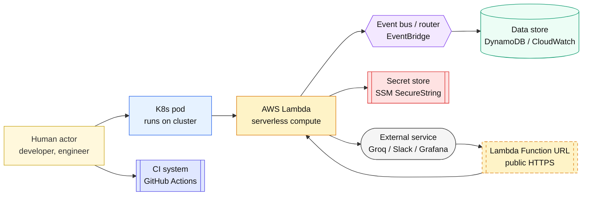

**Arrow conventions:**
- **Solid** (`-->`) — request/response, data write.
- **Dashed** (`-.->`) — asynchronous / log emission / eventual consistency.
- **Labeled** (`-->|"..."|`) — includes the payload or method (e.g., `PutItem`, `HMAC-signed POST`).

---

## §1 — System context (the "one-slide" view)

The whole system in one diagram — everything outside the box is external.

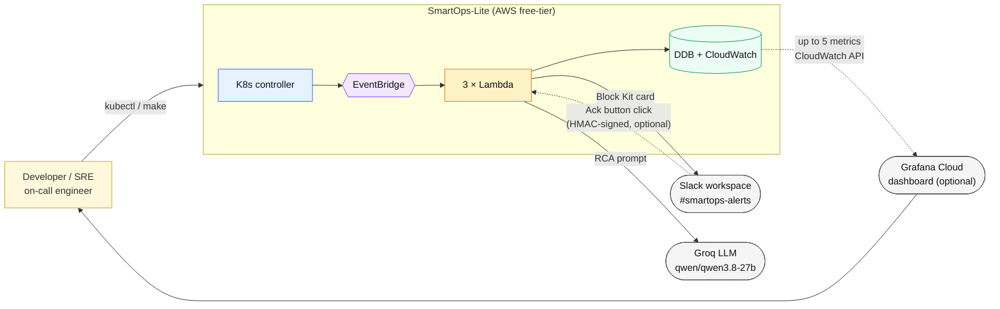

**What this shows.** The whole system is one box. Everything outside — Slack, Groq, Grafana, the developer — is a boundary integration.
**What to say in interviews.** "Three external integrations: LLM for enrichment, Slack for alerts (and an optional Ack button), and an optional Grafana dashboard. Everything inside is on AWS free tier."

---

## §2 — Component architecture (the master diagram)

Same picture, with every internal component named. This is the diagram to draw on a whiteboard.

```mermaid
flowchart LR
    %% Actors
    Dev[Developer<br/>make tf-apply / make chaos-crash]:::actor

    %% K8s cluster
    subgraph K3S["K3s cluster — 2 × t3.micro (multi-AZ)"]
        direction TB
        Crashy["crashy-app<br/>(FastAPI, 2 replicas)<br/>hard anti-affinity"]:::pod
        Ctrl["smartops-controller<br/>(K8s watch → EventBridge)<br/>LRU dedup (4096)"]:::pod
        Crashy -.->|"pod events<br/>CrashLoop / OOM / etc."| Ctrl
    end
    Dev -->|"kubectl / helm"| K3S

    %% Event bus + Lambdas
    Bus{{"EventBridge<br/>custom bus 'smartops-dev'"}}:::bus
    Ctrl -->|"IncidentDetected<br/>schema v1.0"| Bus

    RcaFn["rca-generator<br/>Lambda (Python 3.12)"]:::lambda
    Rem["remediator<br/>Lambda (Slack Ack)"]:::lambda
    Mttr["mttr-aggregator<br/>rate(5 min)"]:::lambda

    Sched{{"EventBridge default bus<br/>schedule rule"}}:::bus
    Bus -->|"rule: IncidentDetected"| RcaFn
    Sched -->|"rate(5 minutes)"| Mttr
    Rem -.->|"RemediationRequested<br/>(no consumer yet — Module 7.1)"| Bus

    %% Persistence + secrets
    DDB[("DynamoDB<br/>smartops-incidents<br/>on-demand")]:::store
    SSM[["SSM SecureString<br/>slack_webhook · groq_api_key<br/>(+ optional slack_signing_secret)<br/>KMS aws/ssm"]]:::secret
    RcaFn -->|"GetParameters<br/>batched, cold-start"| SSM
    RcaFn -->|"PutItem<br/>idempotent by incidentId"| DDB
    Rem -->|"UpdateItem<br/>rcaStatus→acknowledged<br/>(conditional)"| DDB
    Rem -->|"GetParameter<br/>signing secret"| SSM
    Mttr -->|"Scan<br/>60-min window"| DDB

    %% External services
    Groq(["Groq LLM<br/>qwen/qwen3.8-27b<br/>free tier"]):::ext
    Slack(["Slack workspace<br/>#smartops-alerts"]):::ext
    RcaFn -->|"chat/completions<br/>urllib.request"| Groq
    RcaFn -->|"Block Kit card"| Slack
    Slack -.->|"block_actions POST<br/>HMAC-SHA256 signed<br/>(optional)"| RemURL
    RemURL[["Lambda Function URL<br/>HTTPS, no API GW"]]:::fnurl
    RemURL --> Rem

    %% Observability
    CW[("CloudWatch<br/>metrics: SmartOps (≤ 5 no-dim)<br/>logs: /aws/lambda/*")]:::store
    Mttr -->|"PutMetricData"| CW
    RcaFn -.->|"stdout logs"| CW
    Rem -.->|"stdout logs"| CW

    Graf(["Grafana Cloud<br/>free tier (optional)"]):::ext
    CW -.->|"CloudWatch DS<br/>+ Logs Insights"| Graf
    Graf -.-> Dev

    %% CI/CD
    GH[["GitHub Actions<br/>ci.yml + security.yml"]]:::ci
    Dev -->|"git push"| GH
    GH -.->|"lint / test / Trivy / Gitleaks"| K3S

    classDef actor    fill:#fff8dc,stroke:#c8a417,color:#333;
    classDef pod      fill:#e6f2ff,stroke:#2563eb,color:#111;
    classDef lambda   fill:#fef3c7,stroke:#d97706,color:#111;
    classDef bus      fill:#f3e8ff,stroke:#7c3aed,color:#111;
    classDef store    fill:#ecfdf5,stroke:#059669,color:#111;
    classDef secret   fill:#fee2e2,stroke:#dc2626,color:#111;
    classDef ext      fill:#f5f5f5,stroke:#525252,color:#111;
    classDef fnurl    fill:#fef3c7,stroke:#d97706,color:#111,stroke-dasharray: 5 5;
    classDef ci       fill:#e0e7ff,stroke:#4f46e5,color:#111;
```

**What to notice.**
- **Decoupled at EventBridge.** The controller only knows the bus; the rule decides who consumes. The 5-minute schedule that drives the aggregator is a separate rule on the account's default bus.
- **Return path (optional).** Slack Ack → Function URL → remediator. NO API Gateway in between.
- **Dashed arrows** are log/async emits or optional paths — not synchronous dependencies.
- **Controller and app logs stay in the cluster** (`kubectl logs`). No log agent runs on the nodes; only the Lambdas log to CloudWatch.
- **No open ports on the cluster.** kubectl reaches K3s via SSM Session Manager port-forward (implicit from `make kube-config`).

**Source `.mmd`.** [`docs/diagrams/architecture.mmd`](diagrams/architecture.mmd) — regenerate PNG via `npx @mermaid-js/mermaid-cli` or paste at [mermaid.live](https://mermaid.live/).

---

## §3 — Deployment topology (where things physically run)

Same components, arranged by *where they physically live*.

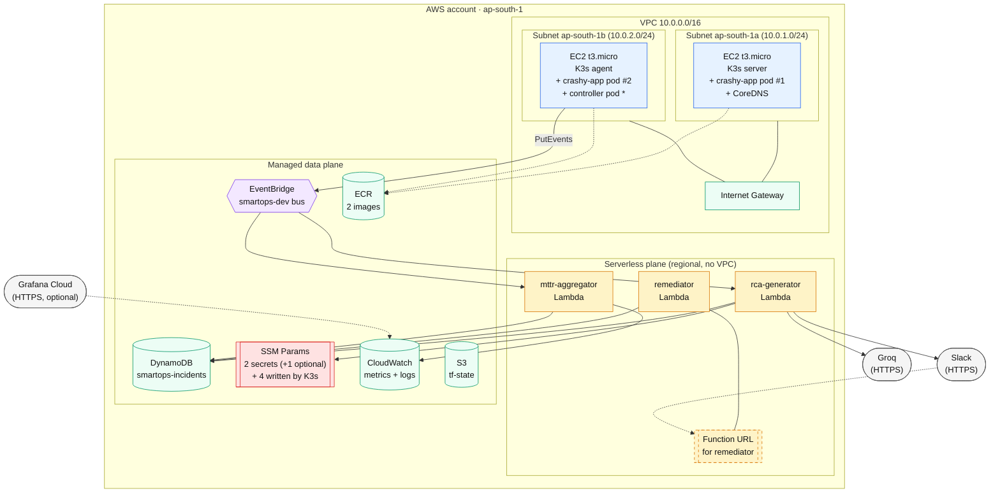

**What to notice.**
- **crashy-app is spread 1-per-AZ.** Hard anti-affinity on `topology.kubernetes.io/zone` forces this — no two pods in the same AZ, ever.
- **\* The controller can land on either node** (single replica, cluster-scoped RBAC, no node pinning). In the recorded run the scheduler put it on the agent. Both nodes share one IAM role, so it can publish from either.
- **Lambdas are outside the VPC.** No NAT Gateway needed → free.
- **Everything managed is single-region** (`ap-south-1`). Multi-region would multiply cost — out of scope for demo.
- **Egress-only external calls** — Slack/Groq return via Function URL (Slack) and HTTPS response (Groq). No inbound to VPC.

---

## §4 — Sequence flows (temporal traces)

### §4.1 Happy path — pod crash to Slack card

The full path from `GET /crash` to a rendered Slack Block Kit card. ~5 seconds end-to-end.

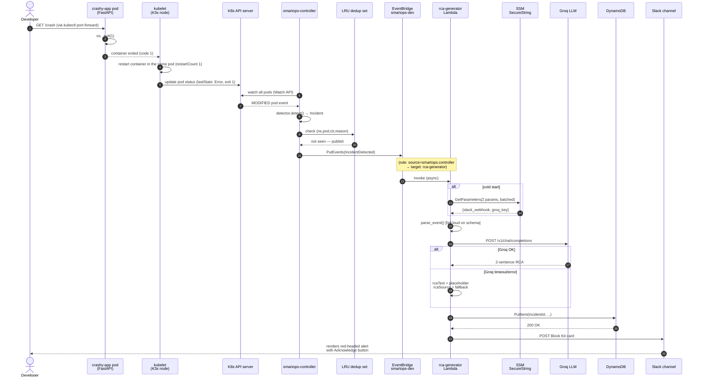

**What to say in interviews (§4.1).**
"From `GET /crash` to Slack card in ~5 seconds. Key design points: LRU dedup so 20 crashes/min → 1 Slack card, cold-start-only secret loading so warm invocations skip SSM, fail-loud on schema (EventBridge retries) but fail-soft on Groq (placeholder text, DDB + Slack still land)."

### §4.2 Ack path — Slack button to DDB update

What happens between the click and the "acknowledged" footer appearing.

> **Optional — not exercised in the recorded run.** The remediator Lambda and its Function URL are deployed and covered by 40 unit tests. To turn the button on, store the signing secret (`make put-signing-secret`) and set the Slack app's Interactivity Request URL to `make remediator-url` (see [`modules/07-remediator.md`](modules/07-remediator.md)).

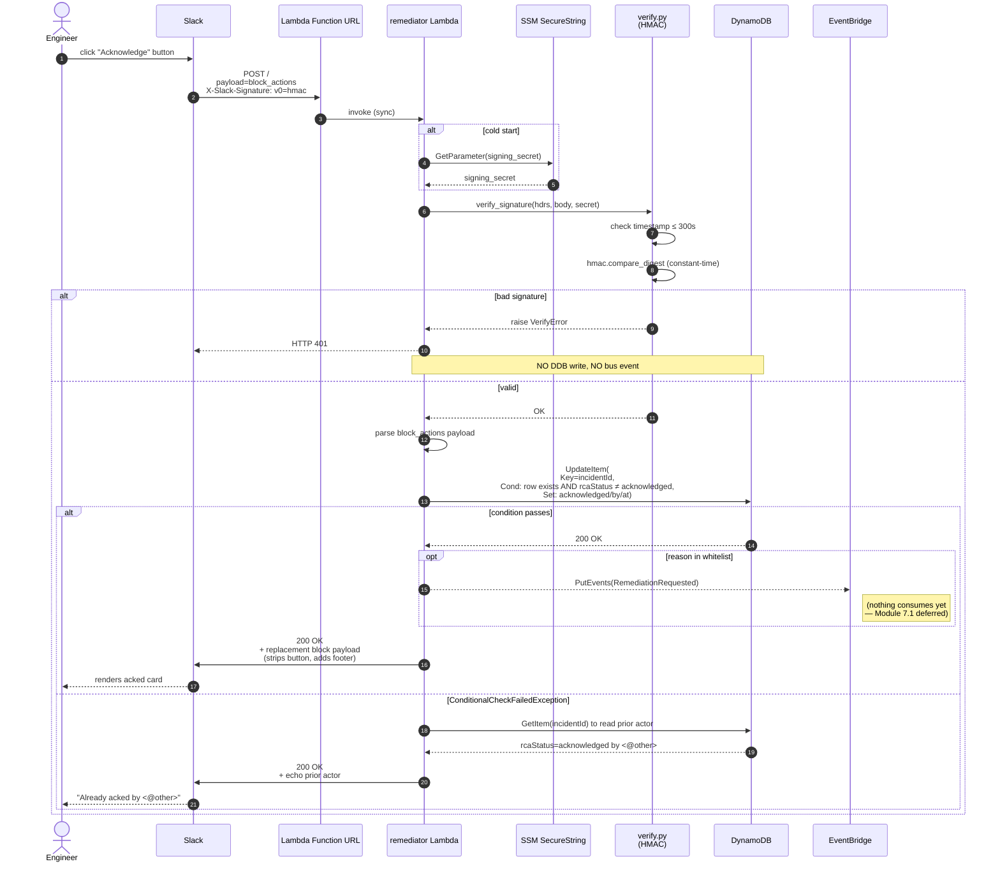

**What to say in interviews (§4.2).**
"Three protections stacked: HMAC-SHA256 (proves Slack), 5-minute replay window (defeats replay attacks), conditional DDB update (defeats double-ack race). And `hmac.compare_digest`, not `==` — constant-time compare defeats timing side-channels."

### §4.3 MTTR aggregation — 5-min tick to Grafana

How dashboards get populated. In the recorded run the metrics were checked with `make cloudwatch-metrics-mttr` and the CloudWatch console; the Grafana half is optional.

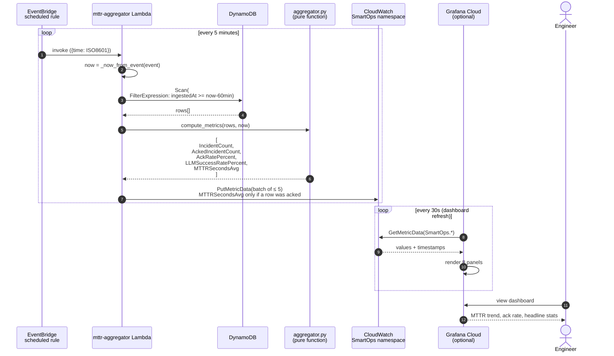

**What to say in interviews (§4.3).**
"Deterministic aggregation window — reads `event['time']` from the schedule tick, not `datetime.now()`. Aggregator core is a pure function — 32 tests with no mocks. 5 no-dimension metrics fits the 10-metric free-tier ceiling with 100% headroom. Per-reason breakouts move to CloudWatch Logs Insights queries (free within 5 GB/mo)."

### §4.4 Lambda cold-start — secrets through KMS

Where secrets come from + why cold-start-only loading matters.

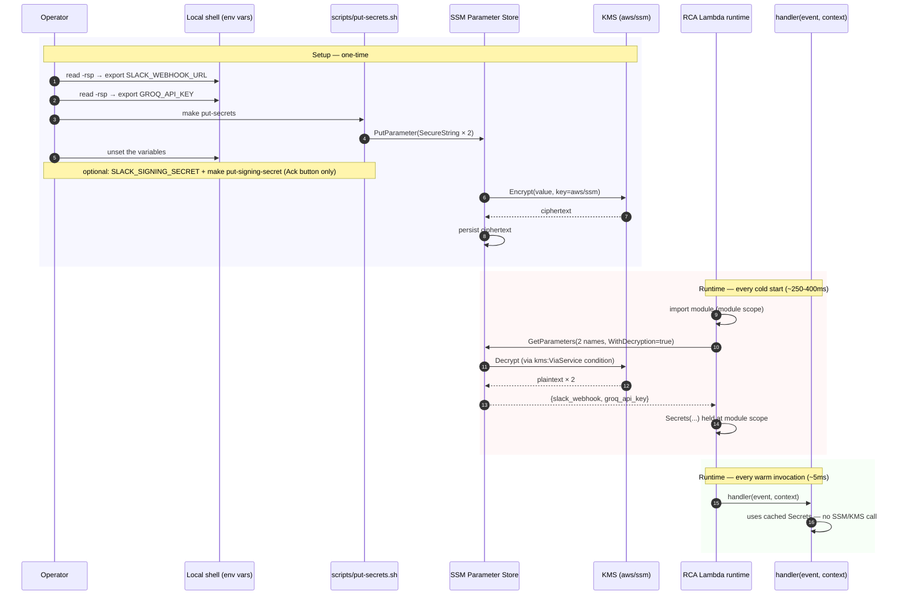

**What to say in interviews (§4.4).**
"Cold-start-only secret loading. `Secrets.load()` at module scope runs once per cold container; warm invocations reuse. Batched `GetParameters` fetches both secrets in one API call (the remediator reads its signing secret the same way, separately). `kms:ViaService` condition on the Lambda's IAM policy scopes decrypt to *only via SSM* — tightest possible KMS scope. Total setup cost + runtime cost sits inside SSM + KMS free tier permanently."

---

## §5 — State machines

### §5.1 Incident lifecycle

Every DDB row goes through this state machine.

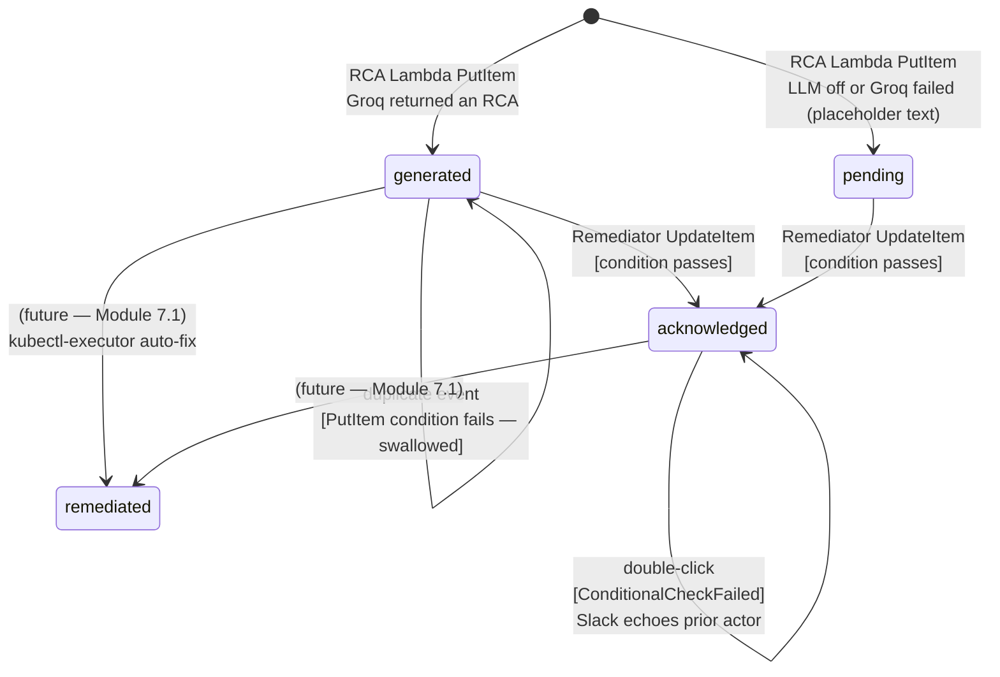

Rows are never deleted in dev: the DynamoDB module supports TTL, but `infra/envs/dev/main.tf` sets `enable_ttl = false`. Nothing was acknowledged in the recorded run, so no row reached `acknowledged`.

**Fields on the DDB row per state:**

| State | rcaStatus | acknowledgedBy | acknowledgedAt | remediationEvents |
|---|---|---|---|---|
| `generated` | `"generated"` | ∅ | ∅ | ∅ |
| `pending` | `"pending"` | ∅ | ∅ | ∅ |
| `acknowledged` | `"acknowledged"` | Slack user ID | ISO 8601 | ∅ |
| `remediated` (future) | `"remediated"` | Slack user ID | ISO 8601 | array of `RemediationRequested` events |

### §5.2 RCA generation (Groq, fail-soft)

One backend, configured by Lambda environment variables that Terraform sets.

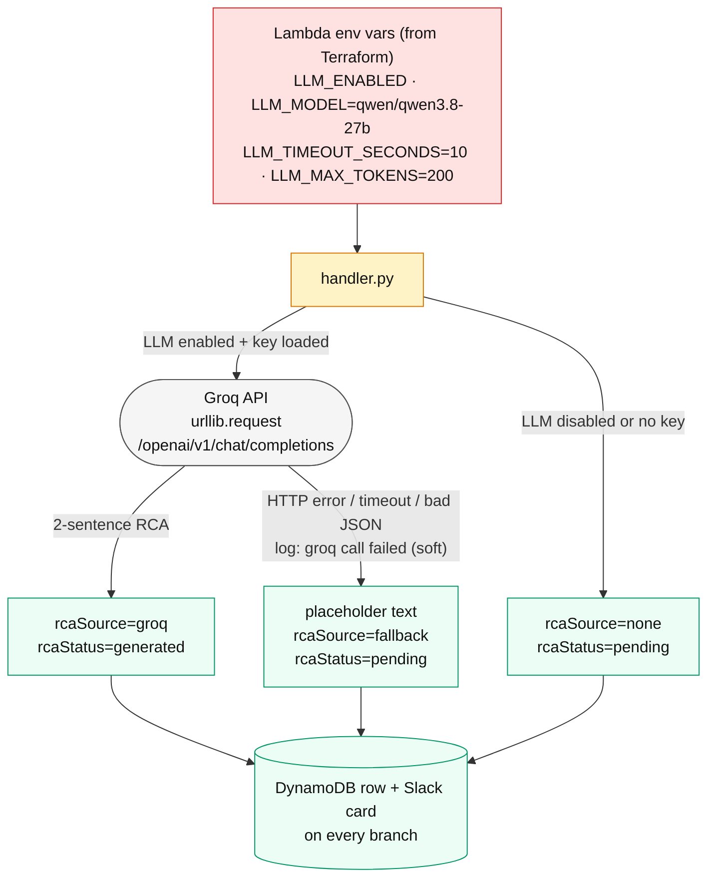

**Why one backend.** [ADR-002](adr/002-ai-backend-choice.md) first planned Groq, Bedrock and Ollama behind one interface; only Groq was built, because it's free and needs no SDK in the Lambda zip. The model is a Terraform variable (`llm_model`), so when Groq retired `llama-3.3-70b-versatile` during the first AWS run, the switch to `qwen/qwen3.8-27b` changed one default and no code.

### §5.3 Publisher factory (DRY_RUN vs real EventBridge)

The controller uses the same code path in prod and local kind demos.

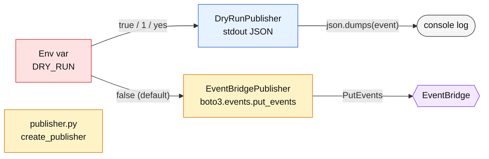

**Why.** Same code path in prod and local. Reviewer running `DRY_RUN=true` in the devcontainer sees the full pipeline in stdout without touching AWS.

---

## §6 — Data flow (where every piece of data lives)

Every piece of data in the system + who reads/writes it.

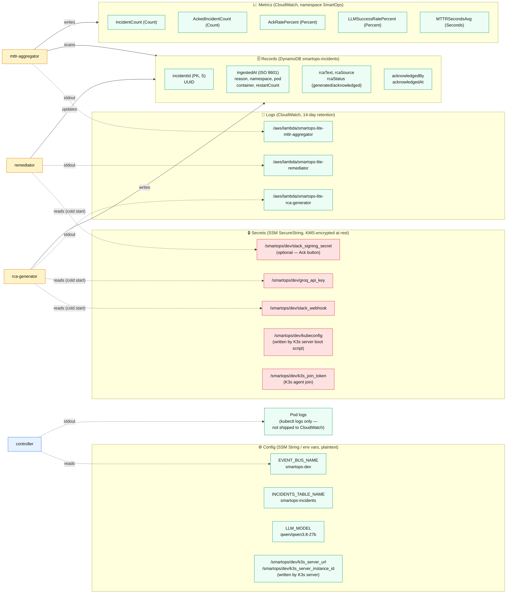

**Key invariants.**
- **Secrets never appear in DDB, CW metrics, CW logs.** Ever. Only SSM.
- **PII-free.** No email/user names in DDB. `acknowledgedBy` is Slack user ID (opaque), not display name.
- **Time is UTC everywhere.** ISO 8601 with `Z` suffix. Aggregator's "now" comes from EventBridge tick, not clock.

---

## §7 — IAM permission graph

Who can do what to what. Every arrow is a policy statement.

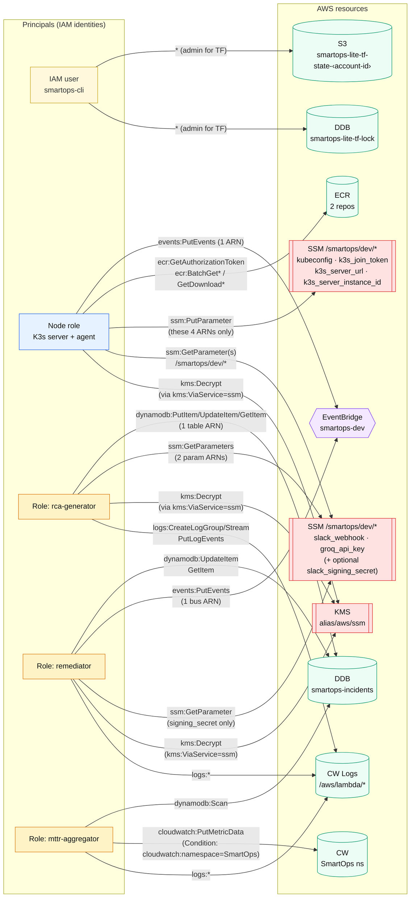

**Least-privilege audit.**
- **RCA Lambda cannot delete DDB rows.** Only PutItem/UpdateItem/GetItem.
- **RCA Lambda cannot write to any other DDB table.** ARN-scoped.
- **Remediator cannot read the Groq API key.** SSM path is exactly `signing_secret`, not `groq_api_key`.
- **Aggregator cannot write to non-SmartOps CloudWatch namespaces.** `cloudwatch:namespace` condition.
- **Every Lambda's KMS Decrypt is scoped via `kms:ViaService`** — only via SSM. Prevents cross-service key abuse.
- **Node compromise blast radius = `events:PutEvents` on one bus + ECR pull + read of every `/smartops/dev/*` parameter (including the Slack webhook and Groq key) + Session Manager (`AmazonSSMManagedInstanceCore`).** The broad parameter read is the main reason per-pod IAM (IRSA) is on the upgrade path.

---

## §8 — EventBridge routing

Every event pattern and its target.

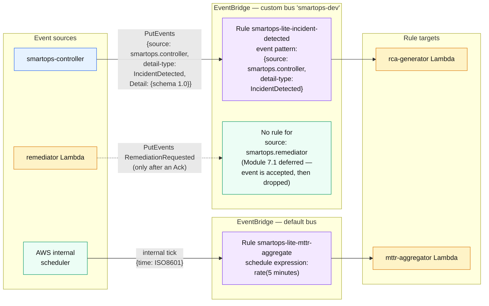

Schedule rules can only run on the default bus, which is why the aggregator's rule isn't on `smartops-dev` (see the comment above `aws_cloudwatch_event_rule.mttr_schedule` in `infra/envs/dev/main.tf`).

**IncidentDetected event shape (schema 1.0)** — what `make chaos-crash` produces. Field names come from `Incident.to_detail()` in `controller/src/smartops_controller/detector.py`; IDs, names and times are placeholders.

```json
{
  "version": "0",
  "id": "<eventbridge-generated-uuid>",
  "detail-type": "IncidentDetected",
  "source": "smartops.controller",
  "account": "<account-id>",
  "time": "2026-09-25T05:52:10Z",
  "region": "ap-south-1",
  "resources": [],
  "detail": {
    "schemaVersion": "1.0",
    "incidentId": "<uuid4>",
    "namespace": "demo",
    "podName": "app-crashy-app-<hash>-<id>",
    "podUid": "<pod-uid>",
    "containerName": "crashy",
    "reason": "Error",
    "restartCount": 1,
    "nodeName": "<node-name>",
    "zone": "ap-south-1a",
    "timestamp": "2026-09-25T05:52:10Z",
    "message": "Error",
    "exitCode": 1,
    "labels": { "app.kubernetes.io/name": "crashy-app", "...": "..." }
  }
}
```

`reason` is `Error` rather than `CrashLoopBackOff` because the detector reports the more specific terminated reason (non-zero exit) when it has one.

---

## §9 — Module dependency graph

The 13 shipped modules + their coupling.

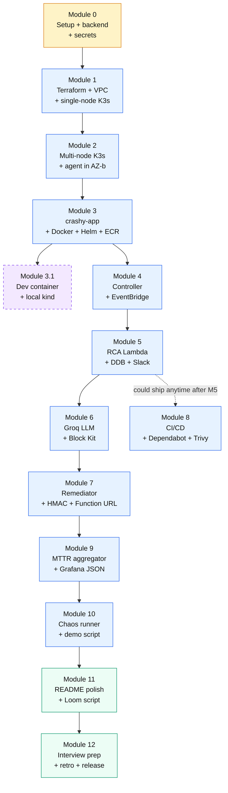

**Read this.**
- **Blue = infrastructure/functional.** Every one builds on the previous.
- **Green = polish + narrative.** README, Loom, interview prep, retro, release.
- **Purple dashed = optional.** Module 3.1 (devcontainer + kind) — reviewers with no AWS.
- **M8 (CI/CD) hangs off M5.** Independent of the M5 → M6 → M7 chain; could have shipped anytime after tests existed.

---

## §10 — Free-tier headroom (cost visual)

Every AWS service we use, with headroom to the free-tier ceiling.

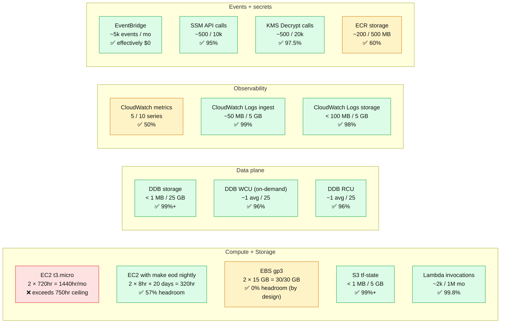

**Reading this diagram.**
- 🟢 **Green** = safe, >50% headroom.
- 🟡 **Yellow** = near ceiling (~50-100% usage) — needs discipline (metrics count, EBS size, ECR image count).
- 🔴 **Red** = exceeds ceiling if left unmanaged — **`make eod` nightly is the only reason we stay green on EC2**.

**What actually happened.** The recorded run used an AWS account on the **Free plan**, where usage is drawn from credits and nothing is charged to the card; $0 was billed. The ceilings above are the classic free-tier limits and still show where the pressure points are. The only paid API calls in the repo are the Cost Explorer ones (`make cost`, `make status`, `SHOW_COST=true make demo`, $0.01 each), and none of the recorded steps use them.

**Interview answer.** "Free tier for real, not by hand-waving. The only ceiling I actively manage is EC2 hours — nightly `make eod` teardown keeps 2 × 24hr from becoming 1440 hr/month. Everything else has >50% headroom. Total demo cost: $0.00 - $0.05/month."

---

## §11 — Teardown decision tree (eod vs nuke)

The two-tier teardown model + when to run each.

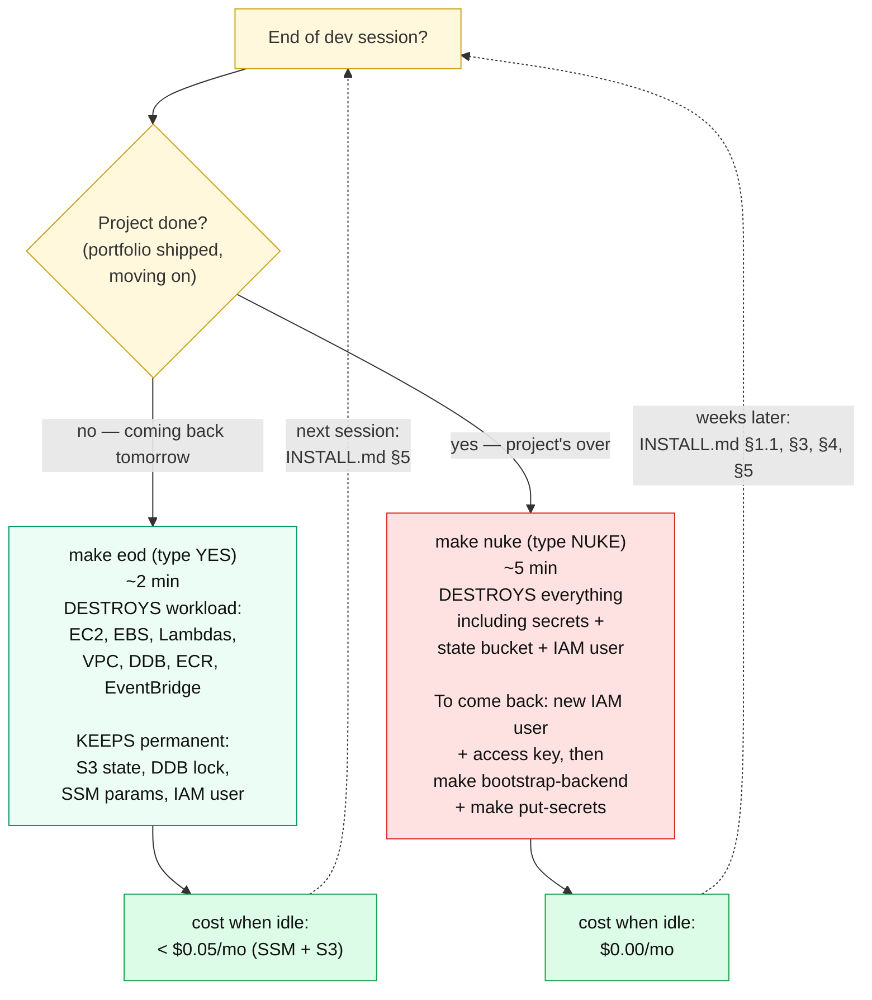

**Interview answer.** "Two-tier teardown. `make eod` at end of every session — destroys workload, keeps permanent shared infra for $0.05/mo. `make nuke` only when the project is actually over — kills everything, back to $0."

`make eod` ends by running `check-orphans.sh`; don't close the laptop until it prints `No orphaned billable resources.` The recorded run ended with `make eod`; `make nuke` wasn't run.

---

## §12 — Directory map

Where every diagram lives in the repo.

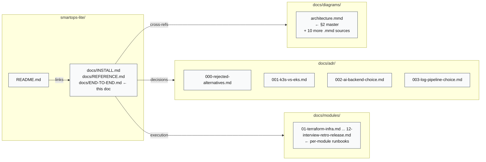

---

## Rendering all diagrams to PNG

You already saw one workflow in `docs/diagrams/architecture.mmd`. To render every diagram in this file as a PNG:

```bash
# One-time
npm install -g @mermaid-js/mermaid-cli

# For a single diagram — extract, save as tmp.mmd, render:
npx @mermaid-js/mermaid-cli -i tmp.mmd -o out.png -w 1600 -H 900 --theme dark

# Or, GitHub renders every ```mermaid block natively — no export needed for repo browsing.
# For LinkedIn / slides, paste each block into https://mermaid.live/ → Actions → PNG.
```

Every diagram in this doc is written to render cleanly on both light and dark GitHub themes. Colors are muted so accessibility (contrast ratio ≥ 4.5:1) holds.

---

## What to read next

- **Running it yourself** → [`docs/INSTALL.md`](INSTALL.md) — accounts, deploy, demo, teardown, troubleshooting.
- **Contributors** → [`docs/modules/`](modules/) — module-by-module implementation runbooks.
- **Decision archaeologists** → [`docs/adr/`](adr/) — why we picked what we picked.

---

**Last verified against code:** 2026-10-20 (SSM parameter names, IAM statements, EventBridge rules and buses, RCA status values, event field names, log group names, LLM settings), and against the recorded AWS run of 25 Sep 2026.
